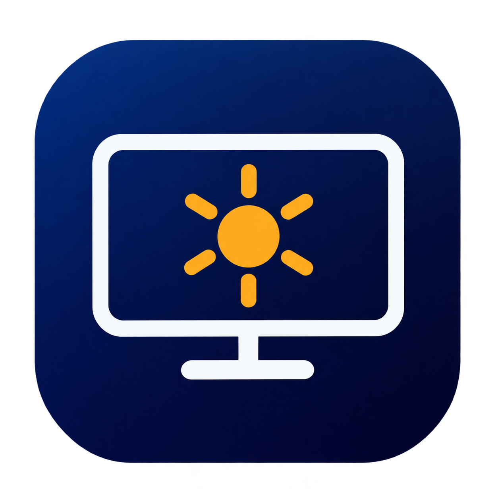
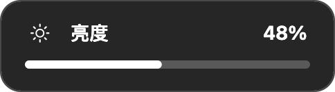

# Display Brightness



[](LICENSE)

[简体中文](README_CHS.md) · [Releases](https://github.com/yi-ge/display-brightness/releases)

Control external monitor brightness from the keyboard on an Apple Silicon Mac. Display Brightness uses DDC/CI to adjust the monitor's backlight and automatically detects compatible displays when you plug them in.



## Requirements

- Apple Silicon Mac. The build targets macOS 13 and later.
- An external monitor and connection that support DDC/CI brightness reads and writes. Some adapters and docks can affect DDC/CI availability.
- [m1ddc](https://github.com/waydabber/m1ddc), installed with `brew install m1ddc`.

The app was tested on macOS 27.0.1 with an RV100 Max. The multi-display selection and hot-plug paths were also tested with simulated displays.

## Install

1. Install [Homebrew](https://brew.sh/) and run `brew install m1ddc`.
2. Download the signed and notarized Apple Silicon DMG from the [latest release](https://github.com/yi-ge/display-brightness/releases/latest).
3. Open the DMG, drag **Display Brightness** into **Applications**, and launch it from there.

If upgrading, quit the previous version and move its app bundle out of Applications before installing the new version.

### Build from source

Install the Apple Command Line Tools and [Homebrew](https://brew.sh/), then build from source.

```sh
xcode-select --install
brew install m1ddc
git clone https://github.com/yi-ge/display-brightness.git
cd display-brightness
./build.sh
mkdir -p "$HOME/Applications"
ditto "build/Display Brightness.app" "$HOME/Applications/Display Brightness.app"
open "$HOME/Applications/Display Brightness.app"
```

## Use

- **Brightness keys**. F1 lowers the brightness and F2 raises it. To enable these keys, open the sun icon in the menu bar, select **启用原生亮度键**, then allow Display Brightness in **System Settings → Privacy & Security → Device Control and Data Access** on macOS 27. On earlier macOS versions, use **Accessibility**.
- **Global shortcuts**. The defaults are **Control + Option + ↓** to dim and **Control + Option + ↑** to brighten. Open **设置…** from the sun menu to record your own shortcuts or restore the defaults. Include at least one of Control, Option, and Command. These shortcuts work without granting keyboard access.
- **Adjustment step**. Use **每次调节幅度** in Settings to change how much each press adjusts brightness.
- **Launch at login**. Enable **登录时启动 Display Brightness** in Settings. If macOS asks for approval, click **打开系统登录项** to open System Settings.
- **Updates**. Version 1.5.0 and later check GitHub Releases automatically. Choose **检查更新…** in the sun menu to check now. Settings lets you turn off automatic checks or opt into automatic download and installation. If you have version 1.4.0 or earlier, install the latest DMG once to enable updates.
- **Display selection**. Choose **控制的显示器** under the sun icon to select a display. Automatic mode prefers the main display when compatible. A saved choice resumes when you reconnect that display.
- **Brightness feedback**. The progress bar shows the brightness reported by the selected monitor, normalized to its hardware range.
- **Black at 0%**. A zero reading blacks out the selected screen while keeping it connected. Raise the brightness to bring the picture back.

## Troubleshooting

- If a monitor is missing, enable DDC/CI in its OSD if that option is available. Use **重新检测显示器** in the menu or run `m1ddc display list` to check which displays are available.
- If another display utility handles the same native keys, turn off its brightness-key handling before using F1/F2 with Display Brightness.
- If macOS shows the permission as enabled after replacing a local build and native keys stop working, quit Display Brightness, run `tccutil reset Accessibility local.rv100-brightness`, reopen the app, and enable its permission again.

## Development

[Contributing](CONTRIBUTING.md) · [Signing and releasing](RELEASING.md) · [Changelog](CHANGELOG.md)

Display Brightness is available under the [MIT License](LICENSE). [Sparkle](https://sparkle-project.org/) handles updates and ships with its own license. The separately installed m1ddc project has its own [MIT License](https://github.com/waydabber/m1ddc/blob/main/LICENSE).
