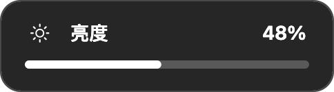

# Display Brightness

[](LICENSE)

[English](README.md) · [发布版本](https://github.com/yi-ge/display-brightness/releases)

Apple Silicon Mac 上的外接显示器亮度工具。通过 DDC/CI 调节显示器背光，接入兼容屏幕后自动识别。



## 使用条件

- Apple Silicon Mac。构建目标为 macOS 13 及以上。
- 显示器和连接方式均支持 DDC/CI 亮度读写。部分转接器和扩展坞可能影响 DDC/CI 通信。
- 运行 `brew install m1ddc` 安装 [m1ddc](https://github.com/waydabber/m1ddc)。

已在 macOS 27.0.1 和 RV100 Max 上进行实机验证。多屏选择和热插拔流程也已通过模拟测试。

## 安装

安装 Apple Command Line Tools 和 [Homebrew](https://brew.sh/)，然后从源码构建。

```sh
xcode-select --install
brew install m1ddc
git clone https://github.com/yi-ge/display-brightness.git
cd display-brightness
./build.sh
mkdir -p "$HOME/Applications"
ditto "build/Display Brightness.app" "$HOME/Applications/Display Brightness.app"
open "$HOME/Applications/Display Brightness.app"
```

如果[发布页](https://github.com/yi-ge/display-brightness/releases)提供已公证的 DMG，打开镜像后可将 Display Brightness 拖入「应用程序」并启动。两种方式都需要 m1ddc。更新前请先退出旧版，并将旧应用从「应用程序」移出，再启动新版。

## 使用

- **原生亮度键**。F1 调暗，F2 调亮。在菜单栏太阳图标中选择「启用原生亮度键」，再到系统设置「隐私与安全 → 设备控制和数据访问」中允许 Display Brightness。较早的 macOS 对应「辅助功能」。
- **备用组合键**。Control + Option + ↓ 调暗，Control + Option + ↑ 调亮，无需输入权限。
- **选择屏幕**。从太阳图标菜单打开「控制的显示器」。自动模式优先选择兼容的主屏。指定屏断开时会切到另一台兼容屏，接回后恢复该选择。
- **亮度进度条**。根据选中屏幕的硬件亮度上限与回读值显示百分比。
- **0% 黑屏**。回读为 0 时，选中屏幕显示全黑画面，视频连接继续保持。调亮即可恢复。

## 排查问题

- 显示器未出现时，检查显示器菜单里的 DDC/CI 选项，然后点击「重新检测显示器」。也可以运行 `m1ddc display list` 查看可用显示器。
- 若另一个显示工具占用了原生亮度键，请先关闭该工具的亮度键监听。
- 替换本地构建后，如果系统权限显示已开启但按键失效，先退出应用，运行 `tccutil reset Accessibility local.rv100-brightness`，再重新启动并开启权限。

## 开发

[贡献说明](CONTRIBUTING.md) · [签名与发布](RELEASING.md) · [更新日志](CHANGELOG.md)

本项目使用 [MIT 许可证](LICENSE)。单独安装的 m1ddc 也使用 [MIT 许可证](https://github.com/waydabber/m1ddc/blob/main/LICENSE)。
